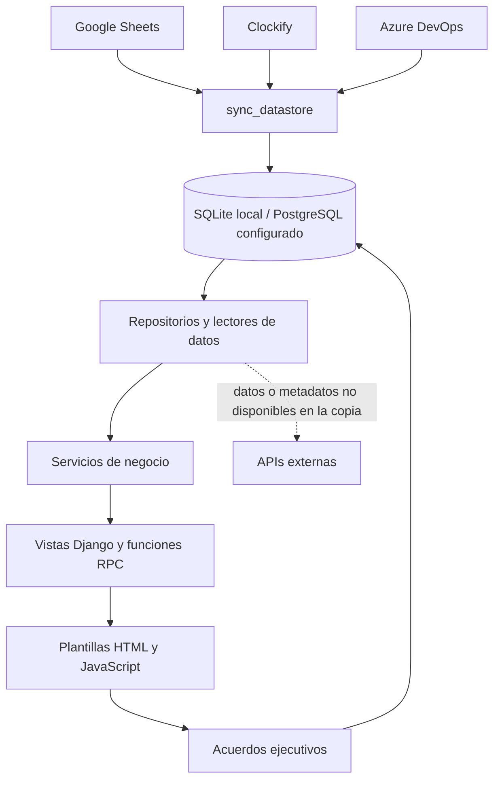

# Análisis del proyecto y de la integración con base de datos

Revisión: 21 de octubre de 2026. Código y base local de `C:\beecker_dashboard`.

## 1. Cómo funciona ahora

Beecker Dashboard es una aplicación Django que reúne información de proyectos,
horas, recursos, finanzas y oportunidades comerciales. Procede de una migración
de Google Apps Script y conserva parte de su frontend y sus contratos de datos.

El cambio de base de datos introduce una copia persistente de las fuentes de
consulta. Muchas pantallas siguen pidiendo una «hoja» o un «reporte de Clockify»
a los mismos servicios de antes; esos servicios pueden entregar ahora la copia
guardada en SQL. Por eso la migración no exigió reescribir todas las vistas.

La base cumple dos funciones diferentes:

- Guarda copias de Sheets, Clockify y Azure para acelerar consultas.
- Guarda información propia de Django, como usuarios, sesiones y acuerdos
  ejecutivos. Estos acuerdos no proceden de una sincronización externa.

Sheets, Clockify y Azure siguen siendo fuentes originales para sus respectivos
datos. Las funciones de edición de los módulos conservan escrituras hacia
Sheets, Azure, Drive o Gmail según la operación. Tener la base no elimina esas
integraciones ni sus credenciales.

## 2. Estado comprobado de esta copia

| Elemento | Resultado |
| --- | --- |
| Configuración local | `config.settings.local` |
| Motor de base local | SQLite, archivo `db.sqlite3` |
| Alternativa prevista | PostgreSQL mediante `DATABASE_URL` |
| Fuente de horas | `TIME_ENTRY_SOURCE=clockify` |
| Lectura de Sheets desde base | Activada: `SHEETS_STORE_ENABLED=1` |
| Lectura de Clockify desde base | Activada: `CLOCKIFY_STORE_ENABLED=1` |
| Lectura de Azure desde base | Activada: `AZURE_STORE_ENABLED=1` |
| Copias de Sheets | 12 hojas y un registro interno de nombres/IDs |
| Clockify | 531,274 registros, 27 meses: agosto de 2024 a octubre de 2026 |
| Azure | 111 proyectos, 39,130 filas de work items y 760 iteraciones |
| Catálogos | 249 clientes, 293 personas y 1,614 IDs de proyecto |
| Acuerdos ejecutivos | 0 registros |
| Candados de sincronización | Ninguno activo al revisar |
| Migraciones de datastore y portal | Todas aplicadas: seis y dos, respectivamente |

Los 1,614 IDs del catálogo incluyen información de distintas fuentes e historial;
no representan 1,614 proyectos activos. Las filas de Azure incluyen los grupos
`latest` y `raid`, por lo que su conteo tampoco equivale a IDs únicos de Azure.

Últimas copias observadas, en horario de Ciudad de México:

- Sheets: 21/10/2026, aproximadamente 08:32.
- Azure: 21/10/2026, aproximadamente 08:33.
- Clockify: 21/10/2026, aproximadamente 08:36; última corrida diaria correcta.

`check_datastore` pasó al ejecutarlo cerca de las 10:15. También comprobé que
el número de registros y la suma de segundos de cada uno de los 27 meses
coinciden con su control `ClockifyMonthSync`. Esto verifica consistencia interna;
no es una conciliación nueva contra las APIs externas.

## 3. Organización del código

| Carpeta o módulo | Responsabilidad |
| --- | --- |
| `config/` | Configuración local, pruebas y producción; conexión SQL, caché y rutas principales. |
| `core/` | Repositorio de Sheets, selección de fuente de horas, registro RPC, errores, cachés y utilidades compartidas. |
| `apps/portal/` | Pantallas actuales, URLs, plantillas, CSS, JavaScript y servicios de presentación/negocio del portal. |
| `apps/datastore/` | Modelos SQL, sincronización, catálogos, candados y revisión de frescura. |
| `apps/dashboard/` | Motor del dashboard original: avance, consumo, costos, salud, alertas y KPIs. |
| `apps/clockify/` | API de horas, vinculación de proyectos, rangos, reportes, tareas, reglas CR y validación. |
| `apps/azure_devops/` | Cliente y gateway de Azure, riesgos RAID, iteraciones y caché. |
| `apps/ejecutivo/` | Resúmenes IXB/RaaS y AER/T&M, detalles de proyecto/cuenta, hitos y riesgos manuales. |
| `apps/capacidad/` | Asignaciones, jornadas, capacidad diaria y rangos de proyectos. |
| `apps/gse/` | Clasificación de horas por persona, área, servicio y categoría; bases mensuales/anuales. |
| `apps/recursos/` | Consultas de personas, proyectos asignados y esfuerzo registrado. |
| `apps/daily/` | Gestión Daily/IXS: work items, RAID, planeación, cliente, comunicación e IA. |
| `apps/aer/` | Gestión de proyectos AER/T&M: personas, planeación, riesgos, acciones e IA. |
| `apps/minutas/` | Lectura de minutas de Drive, extracción de pendientes y escaneo programable. |
| `apps/gmail/` | OAuth, búsqueda de hilos y preparación o envío de respuestas según configuración. |
| `templates/legacy/` | Fragmentos del frontend anterior que siguen reutilizándose. |
| `design/` y `DESIGN-IS-2026-10-20/` | Propuestas y revisiones de diseño; no son las vistas servidas por las rutas actuales. |
| `tests/` | Pruebas de negocio, integración local, paridad con versiones anteriores y JavaScript. |
| `scripts/` | Programación de sincronizaciones, revisión y precalentamiento. |

El patrón habitual es `URL → views.py → services/ → lector de datos → plantilla`.
El frontend de proyecto también usa `JavaScript → RPC → services/`.

## 4. Qué guarda cada grupo de tablas

Los modelos principales están en `apps/datastore/models.py`.

| Modelos | Qué guardan | Cómo los consume la aplicación |
| --- | --- | --- |
| `SheetSnapshot` | Una matriz JSON completa por hoja y su fecha de sincronización. | El repositorio conserva la interfaz de lectura de Sheets. |
| `ClockifyTimeEntry` | Registros individuales con proyecto, usuario, tarea, etiquetas, fecha y duración. | Los lectores reconstruyen reportes y registros compatibles con la lógica existente. |
| `ClockifyMonthSync` | Cobertura mensual, cantidad, segundos y corrida que guardó el mes. | Determina si un mes ya está disponible y ayuda a invalidar cachés. |
| `AzureProject`, `AzureWorkItem`, `AzureIteration` | Copias de proyectos, work items, RAID e iteraciones, incluidos sus payloads. | El gateway de Azure entrega la copia cuando corresponde. |
| `Client`, `ClientAlias`, `Person`, `PersonAlias`, `Project` | Catálogos con nombres normalizados, variantes y asociaciones. | Sincronización y administrador de Django. |
| `SyncRun`, `SyncLock` | Corridas de Clockify y exclusión de procesos de sincronización simultáneos. | Comandos y control operativo. |
| `ExecutiveAgreement` —en `apps/portal/models.py`— | Acuerdos/pendientes, reunión, responsable, vencimiento y estado. | Endpoint de acuerdos de Ejecutiva mediante ORM y formulario Django. |

La migración es parcial respecto de un modelo relacional de negocio: Sheets
todavía se guarda como JSON y sus columnas se interpretan en Python. La mayoría
de los cálculos del portal no consulta directamente `Project`, `Client` o
`Person`; continúa leyendo las hojas mediante el repositorio.

Por esa razón, unir un alias en el administrador no implica automáticamente
que todos los rankings o filtros del portal cambien: habría que conectar esos
cálculos con los catálogos normalizados.

## 5. Cómo se elige entre base, caché y API

### Sheets

`core/sheets/factory.py` construye `GoogleSheetRepository`. Con la bandera de
base activa utiliza `StoredSheetReadCache`, definido en
`core/sheets/store_read_cache.py`.

Se guardan estas hojas: `Proyectos`, `Historico_Proyectos`, `MPB`, `ROC`,
`DataRevenue`, `Recursos`, `Riesgos`, `Bandas/rol`, `Master rates`,
`Banda salarial`, `Backlog_Proyectos` y `CatalagoProyectos`.

La copia persistida no vence automáticamente. Se renueva con la sincronización.
Si falta, el repositorio puede obtenerla de Google y guardarla. Una escritura
de la aplicación invalida la copia afectada para renovarla en la siguiente
lectura. Las hojas que no están en esa lista siguen usando la caché normal y
Google; por ejemplo, existen otras hojas de gestión específicas de proyecto.

### Clockify

`core/time_entries/factory.py` selecciona Sheets o Clockify.
`ClockifyTimeEntryLoader` resuelve el ID interno, el proyecto de Clockify y
sus fechas. Para meses sincronizados puede leer `ClockifyTimeEntry`; si falta
la cobertura, descarga el reporte. Después aplica filtros de fechas, tareas,
variantes de proyecto y deduplicación.

GSE y Facturabilidad reciben los meses SQL mediante `StoredBaseStore`.
EVA 4 puede construir su índice anual desde SQL; si no se cumple la condición
de cobertura de ese índice, conserva el camino de la hoja anual de Clockify.

La lista de proyectos de Clockify y algunas tareas siguen consultándose por
API cuando no están en caché. Por tanto, almacenar las horas no convierte
todas las vistas en completamente independientes de Clockify.

### Azure

`apps/azure_devops/gateway.py` entrega proyectos, work items, RAID e iteraciones
desde la base cuando están disponibles. Si no lo están, utiliza caché/API.
El RAID incorpora una versión para invalidarlo después de crear registros.
También existen consultas y escrituras puntuales mediante el cliente de Azure.

### Cachés de resultados

Además de SQL, hay una caché compartida en archivos `.cache/` y pequeñas
cachés en memoria. Finanzas, Operativa, facturabilidad y los detalles guardan
resultados ya calculados, con vencimientos distintos. Algunos cortes se
conservan 24 horas y tienen una marca de frescura más corta.

En consecuencia, hay tres fechas diferentes: la fecha del dato original,
la fecha de sincronización SQL y la fecha del cálculo mostrado. Recargar
una página no equivale a sincronizar las tres fuentes.

## 6. Mapa de vistas actuales

Las rutas están en `apps/portal/urls.py`; sus funciones, en
`apps/portal/views.py`; las plantillas, en `apps/portal/templates/portal/`.

| Ruta o grupo | Función y fuentes principales |
| --- | --- |
| `/` | Ejecutiva / Business Overview. Presenta cortes preparados de finanzas, operaciones y comercial, con selector de periodo y acuerdos. La preparación pesada puede ejecutarse en segundo plano. |
| `/operativa/` y `/operativa/datos/` | Portafolio, salud, managers y tarjetas EVA. La entrada muestra el corte disponible y JavaScript pide bloques de datos por separado. |
| `/comercial/` | Backlog real desde `Backlog_Proyectos`: filtros, paginación, pipeline y conversión a USD cuando hay cotización válida. |
| `/operativa/eva-1/` | Proyectos IXB/RaaS, con datos históricos, presupuesto, consumo y Azure. |
| `/operativa/eva-2/` | Vista conservada de IXB/RaaS; comparte el cargador de EVA 1. |
| `/operativa/eva-3/` | Proyectos AER/T&M desde MPB y consumo de Clockify. |
| `/operativa/eva-4/` | Servicio continuo: clientes, renovaciones y procesos desde ROC, con horas por proyecto/tarea/etiqueta del mes seleccionado. |
| `/operativa/delivery-manager/<slug>/` | Proyectos y métricas del manager, con carga de información e inversión según la etapa solicitada. |
| `/cuenta/<slug>/` | Información operativa de la cuenta y componentes financieros según sus fuentes y cortes disponibles. |
| `/proyectos/<id>/` | Detalle completo de proyecto. Entrega una estructura inicial y el JavaScript carga las secciones mediante RPC. |
| `/proyecto/<id>/` | Resumen de proyecto anterior que sigue resolviendo enlaces existentes. |
| `/capacidad-instalada/` | Página interactiva independiente de capacidad; reutiliza el motor de capacidad y RPC. |
| `/operativa/capacidad-instalada/` | Alternativa de lectura servida por Django, con exportación CSV. |
| `/operativa/facturabilidad/` | Resultado global del periodo, utilizando GSE, horas y plantilla/bandas. |
| `/operativa/facturabilidad/especialidad/` | Desglose por especialidad/área. |
| `/operativa/facturabilidad/recurso/` | Desglose por persona. |
| `/operativa/facturabilidad/area/` | Página del módulo GSE con sus pestañas y consultas interactivas. |
| `/operativa/inversion/` | Horas clasificadas como inversión comercial u operativa. |
| `/operativa/kpis-delivery-managers/` | Indicadores e historia por periodo; combina MPB, histórico, horas y riesgos. |
| `/operations/resumen/` | Fragmento de resumen Operations. Mantiene la ruta compatible `/operativa/operations-resumen/`. |
| `/ejecutiva/costos/detalle/` | Actualmente abre rentabilidad por oportunidad por defecto; `?vista=proyectos` abre la auditoría de costos por proyecto. |
| `/ejecutiva/oportunidades/` | Margen vendido y real agrupado por oportunidad de DataRevenue. |
| `/ejecutiva/cuentas/` | Listado de cuentas y clasificaciones del corte financiero. |
| `/ejecutiva/acuerdos/` | JSON por GET y creación/actualización por POST de acuerdos SQL. |
| `/ejecutiva/actualizacion/` | Consulta de estado por GET y solicitud de actualización por POST. |
| `/ejecutiva/ingresos/`, `/ejecutiva/costos/`, `/ejecutiva/rentabilidad/`, `/ejecutiva/cuentas/rentabilidad/`, `/cuenta/financiera/`, `/ejecutiva/operations/`, `/ejecutiva/comercial/` | Endpoints JSON de los componentes del portal. No todos son páginas HTML. |
| `/diccionario-datos/` | Explicación de indicadores y fuentes para el usuario. |
| `/legacy/` | Redirige a la página actual correspondiente; con un ID de proyecto abre su detalle. |
| `/api/rpc/<funcion>/` | Ejecuta funciones conservando los nombres del frontend Apps Script. |
| `/gmail/…` y `/admin/` | Conexión de Gmail y administración Django. |

Hay una diferencia de nombres heredada: `load_eva1()` carga AER/T&M y se usa
en la pantalla EVA 3; `load_eva2()` carga IXB/RaaS y se usa en EVA 1 y EVA 2.
Para modificar una pantalla hay que seguir su URL y función, no deducir la
fuente por el nombre del cargador.

## 7. Frontend y reglas que hay que conservar

`base.html` define navegación, estilos compartidos, estado de actualización
y regreso entre páginas. Los archivos CSS/JS principales están en
`apps/portal/static/portal/`.

`operativa.js` coordina las respuestas de bloques sin perder datos de otros
componentes. `executive_report.js` presenta los cortes financieros y operativos.
`proyecto_detalle.js`, capacidad y GSE conservan mecanismos del frontend original.
`gas_shim.js` adapta `google.script.run` a llamadas HTTP.

Al iniciar Django se registran **190 funciones RPC**: Daily 89, AER 46,
Clockify 19, Ejecutivo 15, GSE 7, Recursos 5, Minutas 3, Dashboard 2,
Capacidad 2 y Azure 2. Algunas se registran mediante tablas de funciones;
contar únicamente decoradores `@register_rpc` subestima el total.

Reglas especialmente sensibles al cambiar datos o pantallas:

- Los IDs base y variantes `_S#`/`_CR#` no son intercambiables. Las tareas
  separan consumo y evitan contar una misma hora en varios proyectos.
- Los costos combinan horas, banda de la persona y tarifa. Los importes
  incompletos se presentan como parciales o pendientes.
- Ejecutiva utiliza DataRevenue, con filtros de estado/fecha y columna H
  para sus importes principales. Las distintas métricas financieras no
  necesariamente usan el mismo conjunto de estados.
- Comercial utiliza Backlog y cotizaciones externas para convertir a USD.
- En Facturabilidad, la capacidad usa plantilla vigente con horas, días hábiles,
  festivos y jornada. AER se clasifica como fijo; otras horas facturables,
  como variables. Las áreas operativas incluyen DEV, QA, ROC, ARQ, BA y SM.
- El consumo/budget y la facturabilidad/capacidad son porcentajes diferentes.
- Los filtros de periodo de Ejecutiva y Facturabilidad tienen parsers distintos;
  sus parámetros de mes y trimestre no deben asumirse equivalentes.
- Las fechas locales y las marcas UTC almacenadas deben interpretarse con
  `America/Mexico_City`.

## 8. Sincronización y mantenimiento

El comando `sync_datastore` tiene cuatro pasos: `hojas`, `azure`, `clockify`
y `catalogos`. Sin seleccionar pasos ejecuta los cuatro.

| Operación prevista | Comando | Frecuencia definida en scripts |
| --- | --- | --- |
| Copiar hojas/Azure y reconstruir catálogos | `python manage.py sync_datastore --pasos hojas,azure,catalogos` | Cada hora |
| Actualizar horas y catálogos | `python manage.py sync_datastore --pasos clockify,catalogos` | Diaria, 06:00 local |
| Preparar resultados para las pantallas | `python manage.py warm_cache` | Cada 10 minutos |
| Revisar antigüedad | `python manage.py check_datastore` | Cada hora |

La programación está preparada en `scripts/schedule_windows.ps1`,
`scripts/run_job.sh`, `scripts/warm_loop.sh` y una plantilla de pipeline.
La existencia de esos archivos no prueba que las tareas estén instaladas;
esta revisión no comprobó su registro en Windows ni un despliegue remoto.

Clockify selecciona meses abiertos según bloqueo/ventana reciente y compara
totales históricos para detectar cambios. Un cambio que conserva los totales
mensuales puede escapar de esa comparación hasta recargar el mes.

Las hojas se guardan juntas en una transacción; Clockify reemplaza cada mes
en una transacción; Azure actualiza cada proyecto. Un mes/proyecto con error
conserva su copia previa. Eso no constituye una transacción global entre las
tres fuentes. Los candados evitan sincronizaciones simultáneas del mismo paso.

`check_datastore` usa límites predeterminados de tres horas para hojas/Azure
y treinta horas para Clockify del mes actual. No garantiza que todas las
hojas esperadas existan ni que los datos coincidan con la fuente en ese instante.

## 9. Hallazgos relevantes

1. **El README está parcialmente desactualizado.** Aún afirma que los datos
   siguen en Sheets y que las migraciones solo sirven para usuarios/sesiones.
   También conserva descripciones antiguas de Comercial y EVA. El código actual
   y los documentos de base de datos describen una implementación más avanzada.

2. **La lectura SQL está integrada, pero no sustituye todas las dependencias.**
   Las hojas no incluidas, metadatos de Clockify, operaciones de edición,
   cotizaciones, Drive, Gmail e IA siguen utilizando servicios externos.
   Esto explica por qué una pantalla puede consultar Clockify aunque sus horas
   ya estén cargadas en SQL.

3. **Actualizar Ejecutiva no sincroniza toda la base.** El refresco fuerza
   ciertos cálculos y reportes de Clockify, pero la invalidación de Sheets
   utiliza la caché normal; las copias de `SheetSnapshot` siguen disponibles.
   Para incorporar cambios externos de esas hojas corresponde sincronizarlas.
   Conviene distinguir en la interfaz «recalcular» de «actualizar fuentes».

4. **Los catálogos todavía no son la fuente general del portal.** Su existencia
   no garantiza unificación de nombres en todas las vistas. El trabajo restante
   consiste en conectar cada consumidor que deba usar esas relaciones.

5. **Los nombres heredados pueden inducir cambios en el módulo equivocado.**
   Además del cruce de nombres EVA, la URL de detalle de costos abre por defecto
   otra plantilla. Las rutas y los cargadores deben verificarse juntos.

6. **Hay tres pruebas frontend pendientes.** Dos esperan textos/comportamientos
   comerciales anteriores; la tercera no logra extraer el script de una plantilla
   porque presupone una estructura literal antigua. Esos fallos requieren
   reconciliar expectativas y pruebas con el comportamiento vigente; por sí
   solos no demuestran tres fallos visuales de producción.

7. **La primera carga todavía puede hacer trabajo considerable en Python.**
   En la comprobación aislada, EVA 4 y la facturabilidad mensual tardaron cerca
   de seis segundos cada una. No es una medición de producción: usó caché
   temporal vacía y bloqueó consultas externas. El precalentamiento sigue
   siendo relevante incluso al disponer de SQL.

## 10. Validaciones ejecutadas y límites

| Validación | Resultado |
| --- | --- |
| `manage.py check` | Sin problemas reportados. |
| `manage.py showmigrations datastore portal` | Todas las migraciones aplicadas. |
| `manage.py check_datastore` | Fuentes dentro de los límites de frescura al revisar. |
| Control interno de meses SQL | Sin diferencias en conteo de registros ni segundos de los 27 meses. |
| `pytest -q --tb=short --cov-report=term` con exportación JSON | 1,530 pruebas pasan, cobertura 90.81%, 93 advertencias. |
| `ruff check apps core config` | Pasa. |
| `mypy apps core config` | Pasa: 354 archivos fuente. |
| `node --test tests/frontend/*.test.cjs` | 49 pasan y 3 fallan, de 52. |
| Comprobación aislada de 22 rutas | 21 respuestas 200 y la redirección 302 de `/legacy/`. |

Las pruebas frontend que fallaron fueron:

- `tests/frontend/cost_sprint_details.test.cjs`: extracción del script por un
  separador literal que ya no coincide con la plantilla.
- `tests/frontend/executive_report.test.cjs`: espera una referencia textual
  anterior a «Poly», donde ahora se muestra «Pendiente de corte» si falta nota.
- `tests/frontend/financial.test.cjs`: espera el comercial abierto como
  «Pendiente», donde el código actual presenta el importe recibido.

La comprobación de rutas usó el cliente Django, SQL local y una caché temporal
en memoria. Se bloquearon las consultas a servicios externos y la preparación
en segundo plano. Varias rutas devolvieron contenido parcial ante esas consultas
bloqueadas: HTTP 200 no certifica que todos sus indicadores estén completos.
Tampoco ejecutó JavaScript en un navegador ni verificó visualmente cada página.
El ID ficticio del detalle de proyecto solo comprueba su estructura HTML inicial.

No se ejecutaron envíos de Gmail, escrituras en Sheets/Azure, peticiones de IA,
sincronizaciones externas ni una migración a PostgreSQL. No se modificó código
de la aplicación. El resultado permanente añadido es este informe; las bitácoras
y la herramienta de inspección quedaron en `tmp/`, ignorado por Git.

## 11. Dónde intervenir según el siguiente cambio

| Necesidad | Punto de entrada |
| --- | --- |
| Cambiar distribución, textos o estilos | Plantilla correspondiente y CSS/JS de `apps/portal/static/portal/`. |
| Cambiar qué calcula un indicador | Servicio de negocio correspondiente; revisar su fuente y periodo. |
| Cambiar lectura de Sheets | `core/sheets/factory.py`, `repository.py` y `store_read_cache.py`. |
| Cambiar horas, tareas o deduplicación | `apps/clockify/services/time_entry_loader.py` y reglas de alcance/CR. |
| Guardar un dato nuevo propio | Modelo, migración, validación y vista/RPC que lo utiliza. |
| Copiar nuevas fuentes o columnas | Modelos y sincronización de `apps/datastore/`; considerar compatibilidad del lector. |
| Hacer que el portal use catálogos normalizados | Sustituir progresivamente los consumidores de hojas por consultas a esos modelos. |
| Ajustar actualización y carga progresiva | `executive_refresh.py`, `warm_cache.py`, cachés de servicios y JavaScript de la pantalla. |
| Operar con PostgreSQL | Configuración de `DATABASE_URL`, migraciones y proceso de carga en el entorno destino. Copiar el código no traslada el contenido del SQLite local. |
